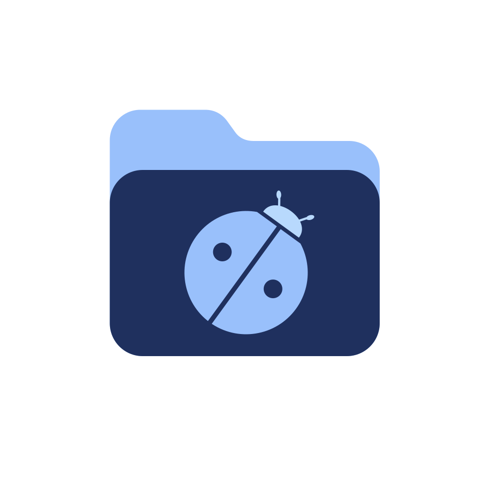

<div align="center">
  
  <h1>Bug On Files M3</h1>
  <p><strong>Bất Ổn Files M3</strong> · Short name: <code>Files M3</code></p>
  <p>
    A fast, Linux-first desktop file manager built with <strong>Tauri v2 (Rust)</strong>,
    <strong>React 19</strong>, and <strong>Material 3 Expressive</strong>.
  </p>
</div>

---

## About & Fork History

**Bug On Files M3** (*Bất Ổn Files M3*) is forked from [`bhimio1/material-3-file-explorer`](https://github.com/bhimio1/material-3-file-explorer), which was originally built with Electron.

This fork rewrites the desktop runtime and filesystem layer onto a native **Tauri v2 + Rust** backend and upgrades the interface to **Material 3 Expressive** using `@bug-on/m3-expressive` and self-hosted `@bug-on/m3-fonts`, while keeping dynamic desktop theming (Matugen / Caelestia / GTK) and adding a logo-driven navy & sky-blue default palette (`#1F305E` / `#99C0FB`).

---

## Tech Stack & UI

| Layer | Technologies |
| --- | --- |
| **Desktop Runtime & Backend** | [Tauri v2](https://v2.tauri.app/) (Rust 2021), `tokio`, `walkdir`, `notify` (file watching), `trash`, `portable-pty`, `image`, `sha2` |
| **Frontend & State** | React 19, TypeScript 5.9, Vite 7 |
| **Design System & Motion** | [`@bug-on/m3-expressive`](https://www.npmjs.com/package/@bug-on/m3-expressive), [`@bug-on/m3-fonts`](https://www.npmjs.com/package/@bug-on/m3-fonts), Tailwind CSS v4, `motion` |
| **Integrated Terminal** | `xterm.js` + `xterm-addon-fit` backed by Rust `portable-pty` |
| **Theming** | Material 3 dynamic tonal palettes (default seed: `#1F305E` Logo Navy) with automatic Matugen / Caelestia / GTK detection |

### UI & Features

- **Material 3 Expressive Interface**: Expressive shapes, connected pill tab bar, collapsible navigation rail & sidebar, and responsive light/dark themes.
- **Native Tauri Splash Screen**: Frameless, transparent logo-only splash window while the main window initializes.
- **Tabbed File Browsing & Virtualized Lists**: Smooth navigation across large directories with background directory size calculation.
- **Unified Omnibar**: Address bar and search integration.
- **Integrated PTY Terminal**: Embedded shell pane synced with your active directory.
- **Quick Look & Media Routing**: Fast preview support for text, images, and video (including custom `media:` protocol streaming and cached thumbnails).
- **Safe File Operations**: Trash/restore/purge support, conflict resolution dialogs, and archive extraction.

---

## Download (Pre-built Releases)

If you prefer not to build from source, download the latest pre-built packages (`.AppImage`, `.deb`, or Arch Linux `PKGBUILD` assets) from [GitHub Releases](https://github.com/nguyentruongton/bug-on-files-m3/releases).

---

## Manual Build & Run

### Common Prerequisites

- **Git**
- **Rust & Cargo** via [`rustup`](https://rustup.rs/) (`stable` toolchain)
- **Bun** (recommended, used in `tauri.conf.json`) or **Node.js 20+ / npm**

---

### Arch Linux (Primary Target & Optimized)

Arch Linux is the primary development and target platform.

1. **Install system dependencies:**

   ```bash
   sudo pacman -S --needed \
     base-devel \
     webkit2gtk-4.1 \
     curl \
     wget \
     file \
     openssl \
     appmenu-gtk-module \
     libappindicator-gtk3 \
     librsvg \
     xdotool
   ```

2. **Optional Arch build optimizations:**

   - **Parallel Rust linking & compilation** (add to `~/.cargo/config.toml` or export in shell):
     ```bash
     # Optional: install mold for significantly faster release/debug linking
     sudo pacman -S --needed mold clang
     ```
     ```toml
     # ~/.cargo/config.toml
     [target.x86_64-unknown-linux-gnu]
     linker = "clang"
     rustflags = ["-C", "link-arg=-fuse-ld=mold"]
     ```
   - The release profile in `src-tauri/Cargo.toml` is already tuned with `codegen-units = 1`, `lto = "thin"`, and `strip = true` for smaller, faster binaries.
   - To install locally from a GitHub Release `.AppImage` on Arch, you can also use the included [`PKGBUILD`](PKGBUILD) (`makepkg -si`) or [`install.sh`](install.sh).

---

### Ubuntu / Debian / Linux Mint

1. **Install system dependencies:**

   ```bash
   sudo apt update
   sudo apt install -y \
     build-essential \
     libwebkit2gtk-4.1-dev \
     curl \
     wget \
     file \
     libxdo-dev \
     libssl-dev \
     libayatana-appindicator3-dev \
     librsvg2-dev
   ```

---

### Clone, Run & Build

1. **Clone the repository:**

   ```bash
   git clone https://github.com/nguyentruongton/bug-on-files-m3.git
   cd bug-on-files-m3
   ```

2. **Install JavaScript dependencies:**

   ```bash
   bun install
   # or: npm install
   ```

3. **Run in development mode (Tauri v2):**

   ```bash
   bun run tauri:dev
   # or: npm run tauri:dev
   ```

4. **Build production bundles (`.AppImage`, `.deb`, binary):**

   ```bash
   bun run tauri:build
   # or: npm run tauri:build
   ```

   Built artifacts will be placed under `src-tauri/target/release/bundle/`.

---

## Dynamic Theming (Matugen / Caelestia / GTK)

By default, **Bug On Files M3** uses the logo's **Logo Navy (`#1F305E`)** and **Sky Blue (`#99C0FB`)** tonal palette. You can also enable system/wallpaper theming via [Matugen](https://github.com/InioX/matugen) (`~/.config/matugen/theme.css`), Caelestia, or GTK theme tokens in Settings.

---

## License

MIT
