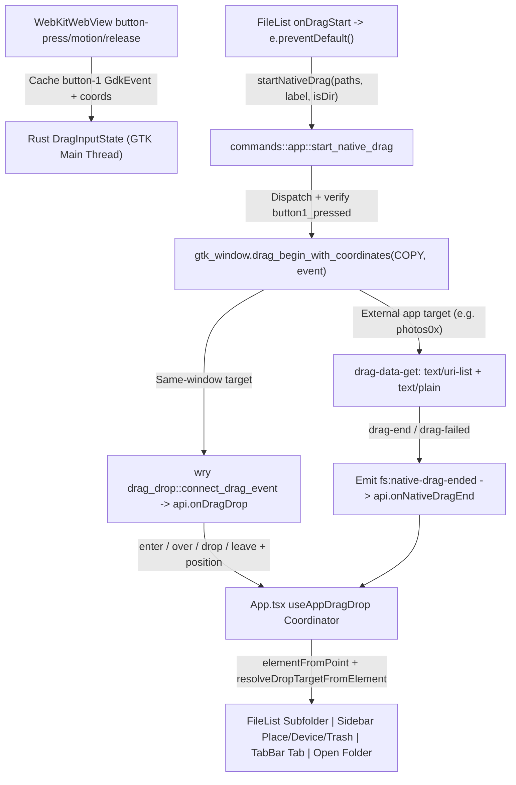

# Native GTK3 Outbound Drag-and-Drop & Unified Internal Drop Targets Design

**Date:** 2026-11-26  
**Status:** Draft (Pending Approval)

---

## 1. Intent and the Why

Currently, outbound drag-and-drop in `src/components/FileList.tsx` (`handleItemDragStart`) relies on browser HTML5 `DataTransfer` (`e.dataTransfer.setData('text/uri-list', ...)` and `setData('text/plain', ...)`). On Linux (`webkit2gtk-4.1` under Wayland/Hyprland and XWayland), WebKit treats JavaScript-initiated `dragstart` payloads as untrusted web content and strips `file://` URIs from `text/uri-list`, advertising only `text/plain` and WebKit-internal atoms over `wl_data_source` / XDND.

As a result:
1. **External applications ignore both file and folder drags:** Apps that require real OS file drag payloads (`text/uri-list` / `GDK_TYPE_FILE_LIST`, surfaced in webviews as `dataTransfer.types.includes('Files')`)—verified directly against `photos0x` (Wails v3 GTK Linux backend + Vue drop zones), as well as browsers, Electron chat/editor apps, and GTK/Qt file dialogs—receive no file drag signal and do nothing when items are dropped onto them.
2. **Internal drag-and-drop onto targets is missing:** Users cannot drag files or folders into subfolders inside `FileList`, into `Places` / `Devices` / `Trash` items on `Sidebar`, or onto open tabs on `TabBar`, nor can external inbound drops target a specific subfolder, Sidebar item, or Tab directly.

This design replaces HTML5 outbound `DataTransfer` with a unified Linux GTK3 native drag source (`gtk_drag_begin_with_coordinates`) paired with an app-level `onDragDrop` coordinator that handles external outbound drags, external inbound drops, and internal folder/Sidebar/TabBar drops seamlessly.

---

## 2. Goals, Non-Goals, and Anti-Goals

### Goals
- **Reliable OS-Native Outbound File & Folder Drag:** Enable dragging single or multiple selected files and directories from both List and Grid views (including active search results, excluding `app://trash`) to external Wayland and XWayland apps (`photos0x`, browsers, chat/editor apps, file managers, and terminals).
- **Dual-Format Native Payload (`text/uri-list` + `text/plain`):** Advertise RFC 8089 `file:///...` URIs (using `url::Url::from_file_path`, with no trailing slash on directories to match GLib `g_filename_from_uri` and Nautilus) alongside `\n`-separated absolute paths in `text/plain` (so terminal emulators continue to paste paths), using `gdk::DragAction::COPY` so external drops never delete or move source files.
- **Native Drag Preview Badge:** Render a compact Cairo drag icon showing a file/folder indicator, truncated primary item name, and a `+N` count badge for multi-item drags (falling back to a standard GTK icon name if surface rendering fails).
- **Unified Internal Drop Targets:** Support dropping dragged items onto:
  - Subfolders inside `FileList` (List rows and Grid cards).
  - `Places`, `Devices`, and `Trash` items inside `Sidebar`.
  - Open tabs inside `TabBar` (immediate drop into directory tabs, plus `550ms` hover-to-switch spring-loaded tab activation).
- **Consistent External Inbound Drop Targeting:** Route external drops from outside Bug On Files M3 through the same target resolver so dropping external files onto a subfolder, Sidebar item, Tab, or open folder background copies them into that exact target.
- **Edge Auto-Scrolling & Deterministic Drag Lifecycle:** Auto-scroll `FileList` and `Sidebar` when hovering near top/bottom edges during a drag, and emit a deterministic `fs:native-drag-ended` event from GTK when a drag ends or fails (even if released over an external window or cancelled with `Esc`) so highlights and deferred `useDirWatch` reloads always settle cleanly.

### Non-Goals
- **Windows or macOS Native Drag Implementations:** Bug On Files M3 targets Linux only; non-Linux targets receive a compile-clean no-op stub.
- **Dragging Items Out of `app://trash`:** Trashed items remain non-draggable (`draggable={!isTrash}` / guard in drag start); users must restore items before moving or sharing them.
- **Drag-to-Reorder Tabs or Sidebar Places:** Tab and Sidebar drag handling in this project is strictly for file/folder drop transfers, not UI item reordering.

### Anti-Goals
- **Adding New Third-Party Dependencies:** Do not add `tauri-plugin-drag`, `drag`, or new npm packages; `gtk = "0.18"` and `gdk = "0.18"` are already resolved in `src-tauri/Cargo.lock` via `tauri` and `wry`.
- **Mutating User Clipboard on Drag-Drop:** Internal drag-move transfers must never overwrite or clear the user's `Ctrl+C` / `Ctrl+X` clipboard in `ClipboardContext`.
- **Silent File Overwrites:** Internal moves reuse `ConflictDialog` (`Replace`, `Skip`, `Keep Both`, `Cancel`); external inbound copies generate non-colliding names via `getUniqueName`; drops onto `Trash` respect `settings.confirmTrash`.

---

## 3. Constraints

- **Wayland Pointer-Press Serial & GTK Device Requirement:** Calling `WidgetExt::drag_begin_with_coordinates` from an async/IPC handler without a valid triggering `gdk::Event` fails under GTK3/Wayland (`gtk_get_current_event()` is `NULL`, causing a `device != NULL` assertion failure or missing the Wayland compositor's implicit pointer grab serial). Rust must capture the latest left-button (`button == 1`) `gdk::Event` on `webkit2gtk::WebView::connect_button_press_event` and track release state on `connect_button_release_event` so stale drags after mouse release abort cleanly.
- **Drag Source Widget Separation:** `drag_begin_with_coordinates` must be invoked on the outer `window.gtk_window()` (`gtk::ApplicationWindow`), **not** on `webkit2gtk::WebView`. Initiating GTK drag directly on `WebKitWebView` collides with WebKitGTK's internal `drag_data_get` / `dragAndDropHelper` overrides, whereas using `gtk::ApplicationWindow` emits clean OS `text/uri-list` + `text/plain` targets externally while allowing `wry`'s `drag_drop::connect_drag_event` on `WebKitWebView` to receive same-window `Enter` / `Over` / `Drop` / `Leave` events identically to external drops.
- **Main-Thread Execution & Coordinate System:** GTK3 widget and event APIs must run on the GTK main thread (`window.run_on_main_thread` or a synchronous main-thread invocation). Inspection of pinned `wry` (`0.57.2`, `src/webkitgtk/drag_drop.rs`) and `tauri-runtime-wry` (`2.12.3`) confirms that `wry` forwards GTK3 `drag-motion` / `drag-drop` `(x, y)` widget coordinates verbatim without scaling (`tauri-runtime-wry` wraps them in `PhysicalPosition` despite GTK3 already reporting widget-logical pixels). Therefore `position` arrives directly in WebKitGTK CSS viewport coordinates (`document.elementFromPoint(position.x, position.y)`), and must **not** be divided by `window.devicePixelRatio`.
- **Virtualized Row Heights:** `FileList.tsx` relies on fixed row/card heights (`FILE_ROW_HEIGHT = 56` in List view, `getGridCardHeight(iconSize)` in Grid view). Drop-target highlight classes must use `ring-inset` and background tints (`ring-2 ring-inset ring-m3-primary bg-m3-primary-container/35`) that never change layout dimensions.
- **IPC Command Parity:** `src/api/__tests__/commandParity.test.ts` asserts exact 1:1 parity between `COMMAND_MAP` and `tauri::generate_handler![...]` in `src-tauri/src/lib.rs` (increasing registered commands from `39` to `40`, while excluding event subscriber `onNativeDragEnd` from `CommandKey`).

---

## 4. Approaches Considered

### Approach 1: Unified GTK3 Native Drag Source + App-Level `onDragDrop` Coordinator *(Selected)*
- **How it works:** Intercept HTML5 `dragstart` in `FileList.tsx` (`e.preventDefault()`), invoke a Rust command `start_native_drag` that calls `gtk_window.drag_begin_with_coordinates` with the captured `gdk::Event` and serves `text/uri-list` + `text/plain` via `drag-data-get`. Handle all in-window hover highlighting, auto-scroll, tab spring-loading, and drop execution inside a single `App.tsx` coordinator listening to `api.onDragDrop` and `api.onNativeDragEnd`.
- **Trade-offs:** Requires ~150–200 lines of Linux-specific GTK3 Rust code and coordinate-based hit-testing (`elementFromPoint`) instead of DOM `onDrop` handlers. In return, it adds zero new external dependencies, guarantees Wayland/Hyprland pointer-grab validity from the first pixel of drag motion, handles external apps (`photos0x`, browsers, terminals) and internal targets through one continuous OS drag session, and gives external drops the exact same subfolder/Sidebar/Tab targeting.

### Approach 2: Third-Party `tauri-plugin-drag` / `drag` Crate + `onDragDrop`
- **How it works:** Add the `drag` crate to handle outbound drags while using `onDragDrop` for internal drop targeting.
- **Trade-offs:** Avoids writing `drag_begin_with_coordinates` glue, but adds an external crate dependency, requires encoding PNG icons through IPC on every drag, omits `text/plain` fallback needed by some terminals, and does not cache the WebKitGTK button-press `gdk::Event` serial reliably under Hyprland.

### Approach 3: Hybrid Split Drag (DOM Pointer Inside Window -> GTK Handoff on Leave)
- **How it works:** Track internal drags with React pointer events while inside the window and trigger GTK native drag only when the pointer crosses the window boundary.
- **Trade-offs:** Simple in-window React hit-testing, but unreliable on Wayland/Hyprland tiling setups: calling GTK drag after the pointer has already left the window or moved past the original press loses the Wayland implicit grab serial, causing the compositor to reject the drag before `photos0x` receives it; also splits internal and external drop logic into two code paths.

**Why Approach 1 was chosen:** The user selected Approach 1 because Wayland/Hyprland requires starting the OS drag synchronously with the originating pointer press to work reliably across external apps like `photos0x`, and unifying internal and external drops under `onDragDrop` avoids duplicated drop pipelines and new dependencies.

---

## 5. User Decisions & Author Calls

### User Decisions
1. **Fix outbound drag-and-drop of both files and folders** from Bug On Files M3 to external applications (specifically verified against `photos0x` and general Wayland/XWayland desktop apps).
2. **Include internal drag-and-drop targets** in the same effort: `FileList` subfolders, `Sidebar` items (`Places`, `Devices`, `Trash`), and open tabs on `TabBar`.
3. **Adopt Approach 1** (Unified GTK3 Native Drag Source + App-Level `onDragDrop` Coordinator).

### Author Calls
> All items below marked `[Author Call]` settle design details cleanly without contradicting user decisions and can be adjusted if requested before approval.

1. **`[Author Call]` Drag Action Semantics (External Copy vs. Internal Move vs. External Inbound Copy):**
   - Outbound native GTK drag advertises `gdk::DragAction::COPY` so external apps (`photos0x`, browsers, editors) never delete or move source files out of the user's folders.
   - Drops originating from inside Bug On Files M3 onto a valid internal folder target (`FileList` subfolder, `Sidebar` Place/Device, or `TabBar` directory tab) execute **Move** (`cut` semantics via `runPaste` + `ConflictDialog`), matching standard Linux desktop file-manager behavior.
   - Drops originating from external applications onto Bug On Files M3 (open folder background, subfolder, Sidebar Place/Device, or directory Tab) execute **Copy** (via `processInboundDrop` with `getUniqueName` collision handling).
2. **`[Author Call]` Dropping onto `Trash` (`Sidebar` Trash or a Tab open to `app://trash`):**
   - Internal drags dropped onto `Trash` route through `App.tsx`'s `handleTrashRequest(items)`, respecting `settings.confirmTrash` (opening the M3 `"Move to Trash?"` dialog when enabled, or trashing immediately when disabled).
   - External drags originating outside Bug On Files M3 are **rejected** on `Trash` targets (`canDrop` returns `false`, no highlight, no-op on drop) to prevent accidentally trashing files from external apps.
3. **`[Author Call]` `TabBar` Dual Interaction (Quick Drop + 550ms Hover-to-Switch):**
   - Dropping immediately onto a `TabBar` directory tab (including inactive tabs) transfers the items directly into that tab's `tab.path` without switching tabs.
   - Hovering a drag over an **inactive** directory tab for `550ms` switches `activeTabId` to that tab (spring-loaded tab), allowing the user to continue dragging straight into a subfolder inside that tab or onto its open folder view.
   - Tabs displaying `app://dashboard` reject drops; tabs displaying `app://trash` accept internal drags (routing to `handleTrashRequest`) and reject external drags.
4. **`[Author Call]` Selection Behavior & Click-Suppression on Drag Start:**
   - Dragging an already-selected item drags all selected items in `sortedFiles` order (preserving multi-selection).
   - Dragging an **unselected** item replaces `selectedFiles` with just that item (`[file]`) and drags it.
   - Starting a native drag sets a short-lived click-suppression ref in `FileList` (cleared on next `pointerdown` or `300ms` after `onNativeDragEnd`) so releasing or cancelling a drag over an already-selected item never accidentally triggers `FileList.tsx`'s single-click-to-open navigation (`if (!isModifier && isSelected) navigate(file)`).
5. **`[Author Call]` Clipboard Isolation & Tab/Search Refresh on Transfer:**
   - `usePaste` exposes a direct `transferFiles(items, operation, destDir)` method that shares `isPastingRef` and `ConflictDialog` with `paste`, without reading from or clearing `ClipboardContext` (`Ctrl+C` / `Ctrl+X`).
   - After a drag-move, drag-copy, or drag-to-Trash completes, normal (non-search) tabs whose `currentPath` matches any affected directory (source parent directory or destination directory) refresh silently without losing scroll position. Tabs in active search mode (`searchActive === true`) stay in search mode and prune moved/trashed source paths from their displayed results in-place rather than discarding the search query.

---

## 6. Architecture & Component Design

### 6.1 Data Flow Overview



### 6.2 Rust Backend (`src-tauri/`)

#### Dependencies (`src-tauri/Cargo.toml`)
Add Linux-target dependencies reusing the exact versions already in `Cargo.lock`:
```toml
[target.'cfg(target_os = "linux")'.dependencies]
gtk = "0.18"
gdk = "0.18"
```
*(Note: `cairo-rs` is pulled transitively by `gtk = "0.18"` via `gtk::cairo` re-export; no extra crate is needed.)*

#### Native Drag Module (`src-tauri/src/native_drag.rs`)
- **Pure Helpers (cross-platform, unit-tested without a display server):**
  - `validate_drag_paths(paths: &[String]) -> Result<Vec<String>, String>`: rejects empty slices, non-absolute paths (`!p.starts_with('/')`), NUL-containing paths, and deduplicates while preserving order.
  - `format_file_uris(paths: &[String]) -> Vec<String>`: converts each absolute path with `url::Url::from_file_path` into RFC 8089 `file:///...` strings without appending trailing `/` to directory paths (ensuring `g_filename_from_uri` and Wails/Electron/Chromium receivers parse files and folders identically).
  - `format_plain_paths(paths: &[String]) -> String`: joins validated paths with `\n`.
  - `build_drag_badge_text(paths: &[String], label: Option<&str>) -> String`: formats display text for the Cairo drag pill (`<name>` when 1 item; `<name> (+N)` when `paths.len() > 1`, truncated cleanly to ~28 chars).
- **Linux GTK3 Integration (`#[cfg(target_os = "linux")]`):**
  - **Window State (`NativeDragState` stored in `Rc<RefCell<...>>` on `gtk_window` via `unsafe`/type-safe GObject data or thread-local `HashMap<String, ...>` keyed by window label on the GTK main thread):**
    - `last_press_event: Option<gdk::Event>`
    - `button1_pressed: bool`
    - `last_pos: (i32, i32)`
    - `active_payload: Option<ActiveDragPayload>` (`paths: Vec<String>`, `uris: Vec<String>`, `plain: String`, `label: String`, `is_directory: bool`)
  - **`install_for_window(window: &tauri::WebviewWindow)`** (called once for `"main"` in `lib.rs` `.setup()`):
    - Obtains `gtk_window = window.gtk_window()` and installs handlers on the inner `webkit2gtk::WebView` via `window.with_webview(...)`:
      - `webview.connect_button_press_event`: when `event.button() == 1`, stores `last_press_event = Some(event.as_ref().clone())`, `button1_pressed = true`, and `last_pos = (x as i32, y as i32)`. Always returns `glib::Propagation::Proceed`.
      - `webview.connect_motion_notify_event`: updates `last_pos` while `button1_pressed` is true. Always returns `glib::Propagation::Proceed`.
      - `webview.connect_button_release_event`: when `event.button() == 1`, sets `button1_pressed = false`. Always returns `glib::Propagation::Proceed`.
    - Connects drag source signals on `gtk_window` (and adds `gdk::EventMask::BUTTON_PRESS_MASK | gdk::EventMask::BUTTON_RELEASE_MASK` if needed):
      - `gtk_window.connect_drag_data_get`: matches `info`:
        - `info == 1` (`text/uri-list`): calls `selection_data.set_uris(&uri_refs)`.
        - `info == 2` (`text/plain` / UTF8 text targets): calls `selection_data.set_text(&payload.plain)`.
      - `gtk_window.connect_drag_begin`: builds a compact HiDPI Cairo `ImageSurface` badge (rounded pill with file/folder indicator and `build_drag_badge_text`) and calls `context.drag_set_icon_surface(&surface)` (falling back to `context.drag_set_icon_name(if is_dir { "folder" } else { "text-x-generic" }, 0, 0)` on any error).
      - `gtk_window.connect_drag_end` and `gtk_window.connect_drag_failed`: clears `active_payload`, sets `button1_pressed = false`, and emits `"fs:native-drag-ended"` to the `"main"` window via `app_handle.emit("fs:native-drag-ended", ())`. (On `drag_failed`, returns `glib::Propagation::Proceed` / `false` so GTK cleans up cleanly.)
  - **`start_drag_on_window(window: &tauri::WebviewWindow, paths: Vec<String>, label: Option<String>, is_directory: bool) -> Result<bool, String>`**:
    - Validates `paths` via `validate_drag_paths`.
    - Runs synchronously on the GTK main thread (dispatching via `window.run_on_main_thread` + `oneshot` channel since Tauri commands run on Tokio threads; if main thread returns within 250ms, returns `bool`, otherwise `Err`).
    - On GTK main thread: verifies `button1_pressed` and `last_press_event.is_some()` (returning `Ok(false)` if the user already released the mouse button).
    - Builds `gtk::TargetList::new(&[])`, calls `targets.add_uri_targets(1)` and `targets.add_text_targets(2)`.
    - Stores `ActiveDragPayload` and calls `gtk_window.drag_begin_with_coordinates(&targets, gdk::DragAction::COPY, 1, press_event.as_ref(), x, y)`.
    - If `Some(_ctx)` is returned, returns `Ok(true)`; otherwise clears `active_payload` and returns `Ok(false)`.
- **Non-Linux Stub (`#[cfg(not(target_os = "linux"))]`)**:
  - `install_for_window(_window: &tauri::WebviewWindow)` is a no-op; `start_drag_on_window(...)` validates paths and returns `Ok(false)`.

#### Command & Registration (`src-tauri/src/commands/app.rs`, `src-tauri/src/lib.rs`)
- Add `#[tauri::command(rename_all = "camelCase")] pub async fn start_native_drag(window: tauri::WebviewWindow, paths: Vec<String>, label: Option<String>, is_directory: bool) -> Result<bool, String>` delegating to `crate::native_drag::start_drag_on_window`.
- Register `commands::app::start_native_drag` in `tauri::generate_handler![...]` in `src-tauri/src/lib.rs`.
- In `lib.rs` `.setup()`, look up `if let Some(main_window) = app.get_webview_window("main") { native_drag::install_for_window(&main_window); }`.

### 6.3 Frontend API Seam (`src/api/`)

- **`src/api/types.ts`:**
  - Add:
    ```ts
    export interface NativeDragRequest {
        paths: string[];
        label?: string;
        isDirectory?: boolean;
    }
    ```
  - Add to `IApi`:
    - `startNativeDrag: (req: NativeDragRequest) => Promise<boolean>;`
    - `onNativeDragEnd: (cb: () => void) => () => void;`
- **`src/api/commandMap.ts`:**
  - Add `'onNativeDragEnd'` to `CommandKey`'s `Exclude` union.
  - Add `startNativeDrag: 'start_native_drag'` to `COMMAND_MAP`.
- **`src/api/tauriAdapter.ts`:**
  - Implement `startNativeDrag: (req) => invoke(COMMAND_MAP.startNativeDrag, { paths: req.paths, label: req.label, isDirectory: req.isDirectory ?? false }) as Promise<boolean>`.
  - Implement `onNativeDragEnd: (cb) => wrapListener(listen('fs:native-drag-ended', () => cb()))`.
- **`src/api/__tests__/commandParity.test.ts`:**
  - Update expected registered command count from `39` to `40`.

### 6.4 Pure Drop-Target Resolution & Auto-Scroll (`src/utils/dropTargetUtils.ts`)

Create a pure, DOM-light utility module tested directly in `bun test`:
- **`ResolvedDropTarget` union:**
  ```ts
  export type ResolvedDropTarget =
      | { kind: 'folder'; path: string; source: 'filelist' | 'sidebar' | 'explorer-root' }
      | { kind: 'tab'; tabId: string; path: string }
      | { kind: 'trash' };
  ```
- **`canDropPathsIntoDir(paths: string[], destDir: string, mode: 'move' | 'copy'): boolean`:**
  - Returns `false` if `paths.length === 0`, `!destDir`, or `destDir.startsWith('app://')` / `destDir.startsWith('search://')`.
  - Rejects if any path is invalid (`!p.startsWith('/') || p.includes('\0')`).
  - Rejects if **any** dragged directory/path satisfies `isSameOrDescendant(src, destDir)` (prevents dropping a folder into itself or its own subtree).
  - For `mode === 'move'`, checks whether at least one dragged path has `getParentDir(src) !== normalizePath(destDir)` (returns `false` if all dragged items are already direct children of `destDir`—e.g., dragging a file back onto the same open folder background or onto the active tab's own pill).
- **`filterActionablePathsForDir(paths: string[], destDir: string, mode: 'move' | 'copy'): string[]`:**
  - Filters out invalid paths, ancestor/self conflicts, and (for both `move` and `copy` when dropping back onto the same parent directory) items whose `parentDir === normalizePath(destDir)`, matching `processInboundDrop` self-drop protection.
- **`resolveDropTargetFromElement(el: Element | null, draggedPaths: string[], mode: 'move' | 'copy', tabsById: Map<string, { path: string }>): ResolvedDropTarget | null`:**
  - Walks up via `el.closest(...)` priority:
    1. `[data-drop-trash="true"]`: returns `{ kind: 'trash' }` only if `mode === 'move'` and `draggedPaths.length > 0` (external drags cannot drop onto Trash).
    2. `[data-drop-tab-id]`: looks up `tab` in `tabsById`. If `tab.path === 'app://trash'`, returns `{ kind: 'trash' }` when `mode === 'move'`. If `tab.path === 'app://dashboard'`, returns `null`. Otherwise validates `canDropPathsIntoDir(draggedPaths, tab.path, mode)` and returns `{ kind: 'tab', tabId, path: tab.path }`.
    3. `[data-drop-folder-path]`: reads `folderPath`, validates `canDropPathsIntoDir(draggedPaths, folderPath, mode)`, determines `'sidebar'` vs `'filelist'` via `closest('[data-drop-sidebar="true"]')`, and returns `{ kind: 'folder', path: folderPath, source }`.
    4. `[data-drop-explorer-root="true"]`: reads `data-explorer-path` and `data-search-active`. If `searchActive === 'true'`, returns `null` (cannot drop onto search results background). Otherwise validates `canDropPathsIntoDir(draggedPaths, explorerPath, mode)` and returns `{ kind: 'folder', path: explorerPath, source: 'explorer-root' }`.
- **`toCssClientPoint(position: { x: number; y: number }): { x: number; y: number }`:**
  - Normalizes finite `(position.x, position.y)` directly as CSS client coordinates without dividing by `window.devicePixelRatio`, matching GTK3 widget-space coordinates forwarded by `wry`.
- **`computeAutoScrollDelta(pointerY: number, rectTop: number, rectBottom: number, edgeZonePx = 48, maxSpeedPx = 12): number`:**
  - Returns negative delta when `pointerY - rectTop < edgeZonePx`, positive delta when `rectBottom - pointerY < edgeZonePx`, and `0` otherwise.

### 6.5 Clipboard-Isolated Transfer & App-Level Coordinator (`src/hooks/usePaste.tsx`, `src/hooks/useAppDragDrop.ts`)

- **`src/hooks/usePaste.tsx`:**
  - Extract shared execution core taking `(items, operation, destDir)` and expose `transferFiles(items: IFile[], operation: 'copy' | 'cut', destDir: string): Promise<PasteResult>` alongside `paste`.
  - `transferFiles` never reads or clears `ClipboardContext`, reuses `isPastingRef` and `ConflictDialog`, shows appropriate action toasts (`"Moved X item(s)"` / `"Copied X item(s)"`), and returns/reports `{ result, movedPaths, affectedDirs }` (source parent directories of succeeded items + `destDir`) via an `onTransferComplete` callback so `App.tsx` refreshes affected non-search tabs silently and prunes `movedPaths` from any active search tab.
- **`src/hooks/useAppDragDrop.ts` (mounted once in `App.tsx`):**
  - Holds `internalSessionRef`: `{ items: IFile[]; paths: string[]; sourceDir: string } | null`.
  - Exposes:
    - `isDragging: boolean` (true whenever an outbound native drag or inbound OS drag is active over the window; passed down so `ExplorerTab` defers `useDirWatch` reloads during drags).
    - `activeDropTarget: ResolvedDropTarget | null` (passed down to `TabBar`, `Sidebar`, `ExplorerTab` / `FileList`).
    - `startOutboundDrag(items: IFile[], sourceDir: string): Promise<void>`: stores `internalSessionRef`, sets `isDragging = true`, arms a 15s safety timeout, and calls `api.startNativeDrag(...)`. If `startNativeDrag` returns `false` or rejects, immediately clears `internalSessionRef`, clears `isDragging`, and stops.
  - Subscribes to `api.onNativeDragEnd` and `api.onDragDrop`:
    - On `enter` / `over`:
      - Determines `mode = internalSessionRef.current ? 'move' : 'copy'` and `draggedPaths = internalSessionRef.current?.paths ?? event.paths ?? []`. (Note: in `wry`, `Over` payloads omit `paths`, so the coordinator caches `lastInboundPathsRef` from `Enter`.)
      - Converts `event.position` via `toCssClientPoint(event.position)` and queries `document.elementFromPoint(x, y)`.
      - Updates `activeDropTarget` via `resolveDropTargetFromElement(...)`.
      - **Spring-loaded tab timer (`550ms`):** If `hovered` target is `{ kind: 'tab', tabId }` and `tabId !== activeTabId` and `tab.path` is a real filesystem directory, starts/keeps a `550ms` timer to call `onSelectTab(tabId)`. Clears timer immediately if pointer moves away or drag ends/leaves.
      - **Edge auto-scroll:** Finds `el.closest('[data-drop-scroll-container="true"]')` and schedules/updates a `requestAnimationFrame` loop calling `scrollEl.scrollBy(0, delta)` using `computeAutoScrollDelta`.
    - On `leave`:
      - Clears `activeDropTarget`, cancels spring-loaded timer and auto-scroll loop. (Does *not* clear `internalSessionRef`—user may be dragging out to `photos0x`!)
    - On `drop`:
      - Resolves final target at `event.position` (falling back to `activeDropTarget`).
      - Cancels timers/auto-scroll and clears `activeDropTarget`.
      - Captures `session = internalSessionRef.current`; clears `internalSessionRef` and `isDragging` (or lets `onNativeDragEnd` idempotently clear).
      - **Execution:**
        - If `target.kind === 'trash'` and `session`: invokes `onTrashItems(session.items)`.
        - If `target.kind === 'folder'` or `target.kind === 'tab'`:
          - If `session` (internal **Move**): filters actionable `IFile` items via `filterActionablePathsForDir(session.paths, target.path, 'move')` and calls `transferFiles(actionableItems, 'cut', target.path)`.
          - Else (external **Copy**): filters `event.paths` via `filterActionablePathsForDir` and calls `processInboundDrop(paths, target.path, false, { exists, copyFile })`, shows `"Imported X file(s)"` toast, and refreshes tabs viewing `target.path`.
    - On `api.onNativeDragEnd`:
      - Idempotently clears `internalSessionRef`, `isDragging`, `activeDropTarget`, spring-loaded timer, and auto-scroll loop.

### 6.6 UI Component Updates

- **`src/components/FileList.tsx`:**
  - Props additions:
    - `activeDropTarget?: ResolvedDropTarget | null`
    - `onStartOutboundDrag?: (items: IFile[]) => void`
    - `onSelectSingle?: (file: IFile) => void` (or call `onSelect(file, false, false)` before starting drag if `!selectedFiles.has(file.path)`)
  - In `handleItemDragStart(e, file)`:
    - Always call `e.preventDefault()` so WebKitGTK's HTML5 drag never runs.
    - If `isTrash`, return early.
    - Set `suppressNextClickRef.current = true` (auto-reset after 300ms post-drag).
    - Determine `dragItems`: if `selectedFiles.has(file.path)` and `selectedFiles.size > 0`, collect selected `IFile` objects in `sortedFiles` order; otherwise select `[file]` via `onSelect(file, false, false)` and use `[file]`.
    - Invoke `onStartOutboundDrag?.(dragItems)`.
  - In `handleItemClick(e, file)`: if `suppressNextClickRef.current` is true, consume and ignore the synthetic click so drag cancellation never navigates.
  - Subfolder rows (List view) and folder cards (Grid view) when `!isTrash && file.isDirectory`:
    - Attach `data-drop-folder-path={file.path}` and `data-drop-active={isDropTarget ? 'true' : undefined}`.
    - Apply highlight styling when `activeDropTarget?.kind === 'folder' && activeDropTarget.source === 'filelist' && normalizePath(activeDropTarget.path) === normalizePath(file.path)`: `ring-2 ring-inset ring-m3-primary bg-m3-primary-container/35`.
  - Attach `data-drop-scroll-container="true"` to `activeScrollRef` in both List and Grid views.
- **`src/components/ExplorerTab.tsx`:**
  - Remove the tab-local `api.onDragDrop` listener, `markDragStarted` / `clearDrag` DOM `onDragStart` / `window` `pointerup` / `mouseup` / `dragend` / `drop` listeners.
  - Accept `isDragging?: boolean`, `activeDropTarget?: ResolvedDropTarget | null`, `onStartOutboundDrag?: (items: IFile[]) => void`, and a directory-scoped silent refresh / moved-path pruning signal (`silentRefreshSignal` / `removedPathsSignal`, or imperative callback ref) from `App.tsx` so affected non-search tabs run `reloadSilently()` without resetting `searchActive` or `scrollTop`, and active search tabs prune moved/trashed source paths from `files` and `selectedFiles` in-place.
  - Keep `useDirWatch` deferral tied to `isDragging`: when `isDragging` transitions `true -> false` and `pendingReloadAfterDragRef.current` is true, run `reloadSilently()`.
  - On the main Explorer content container: attach `data-drop-explorer-root="true"`, `data-explorer-path={currentPath}`, `data-search-active={searchActive ? 'true' : 'false'}`. Show a subtle inset container ring (`ring-2 ring-inset ring-m3-primary/60`) when `activeDropTarget?.kind === 'folder' && activeDropTarget.source === 'explorer-root' && normalizePath(activeDropTarget.path) === normalizePath(currentPath)`.
- **`src/components/Sidebar.tsx`:**
  - Accept `activeDropTarget?: ResolvedDropTarget | null`.
  - Mark Drawer container with `data-drop-sidebar="true"` and `ScrollArea` viewport (or wrapper) with `data-drop-scroll-container="true"`.
  - Wrap or pass `data-drop-folder-path={place.path}` / `data-drop-folder-path={drive.mountpoint}` and `data-drop-trash="true"` onto `Places`, `Devices`, and `Trash` items, applying `ring-2 ring-inset ring-m3-primary bg-m3-primary-container/35 rounded-full` when matching `activeDropTarget`.
- **`src/components/TabBar.tsx`:**
  - Accept `activeDropTarget?: ResolvedDropTarget | null`.
  - Attach `data-drop-tab-id={tab.id}` on each tab button and highlight (`ring-2 ring-inset ring-m3-primary bg-m3-primary-container/35`) when `activeDropTarget?.kind === 'tab' && activeDropTarget.tabId === tab.id` (or when a Trash tab matches `activeDropTarget?.kind === 'trash'`).
- **`src/App.tsx`:**
  - Instantiate `usePaste` (with `onTransferComplete` triggering silent directory refresh on non-search tabs matching `affectedDirs` and pruning `movedPaths` on active search tabs, plus refreshing `app://trash` tabs when items are trashed) and `useAppDragDrop(...)`.
  - Pass `activeDropTarget` to `Sidebar`, `TabBar`, and `ExplorerTab`; pass `isDragging` and `handleStartOutboundDrag` to `ExplorerTab`.

---

## 7. What's Left to the Builder

- Exact Cairo pill typography, border radius, padding, and theme-neutral contrast colors for the GTK3 native drag icon badge in `src-tauri/src/native_drag.rs`.
- Exact Tailwind transition/hover utility classes on `[data-drop-active="true"]` elements across `FileList`, `Sidebar`, and `TabBar` (subject to preserving fixed virtualized row heights).
- Exact auto-scroll ramp constants (`edgeZonePx`, `maxSpeedPx`) and whether `ScrollArea` in `Sidebar` forwards a DOM element with `data-drop-scroll-container="true"` or needs an inner scrollable wrapper ref.
- Comprehensive unit tests in `bun test` (`commandParity.test.ts`, `tauriAdapter.test.ts`, `dropTargetUtils.test.ts`, `FileList` drag/click-suppression tests, `usePaste` `transferFiles` clipboard isolation tests) and `cargo test` (`native_drag` path validation, RFC 8089 URI formatting including spaces/UTF-8/`#`/`%`, directory no-trailing-slash check, plain path formatting, badge label truncation), followed by `cargo clippy --all-targets -- -D warnings`, `bun run lint`, `bunx tsc -b`, and interactive Hyprland verification against `photos0x`, browser upload, terminal paste, subfolders, `Sidebar`, and `TabBar`.
